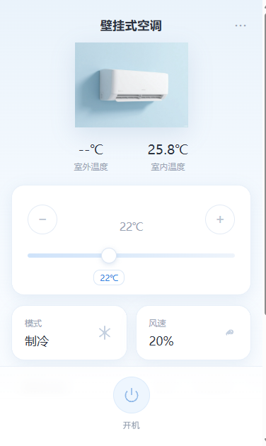
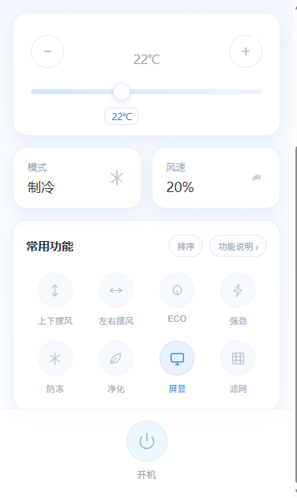

# 美的空调局域网控制台

直接与美的 Wi-Fi 空调在本机网络上通信（TCP 6444 + V3 加密协议），**不经过美的云端**。握手成功后云端就不再有用了，断网、云服务故障都不影响控制。

自带一个手机尺寸适配的 Web 控制台、一个命令行工具，以及一个桌面常驻卡片。

<p align="center">
  
  
</p>

## 功能

**Web 控制台**

- 开关机、17–30 ℃ 无极调温（滑块带跟随度数的浮动标注，拖动时实时预览、松手才下发）
- 制冷 / 制热 / 除湿 / 送风 / 自动
- 风速：自定义百分比（1–100）+ 6 档快捷（自动/静音/低/中/高/强力）
- 快捷功能：上下摆风、左右摆风、ECO、强劲、防冻、净化、屏显、滤网提醒
- 所有控件按设备**真实上报的能力位**渲染，机型不支持的项不会出现
- 点击后就地转圈，成功后才切换到执行后的状态
- 指令下发后**回读校验**，设备没接受时提示「指令未生效」
- 首次连接或密钥失效时弹出设置面板，可一键发现设备并填写 token / key（保存前先鉴权）

**桌面常驻卡片**（`midea_widget.py`）

- 无边框浮窗，**默认贴在桌面最底层**（不遮挡其它窗口），可在菜单里切换为置顶；显示开关机状态、目标温度、室内温度、当前模式与风速
- 点电源圆钮开关机，模式 / 风速按钮切换对应项，操作结果以设备回读值为准
- 可拖动、记忆位置与置顶状态；菜单里可打开完整控制台或创建开机自启
- 纯标准库（tkinter），不新增依赖；数据全部走本地 HTTP 接口

**工程侧**

- 进程内复用单条 TCP 连接（免去每次点击重新握手，热请求约 200 ms）
- UDP 广播自动发现：连接失败时按设备 ID / SN 重新定位，并把新 IP 写回配置
- 失败重连一次、三级超时、请求去重（同参数并发请求只打一次设备）
- 写操作回读校验，配置缺失 / 格式错误 / 鉴权失败统一为中文提示

## 原理

V3 固件不允许"零凭据"连接，链路是：

```
① 云端一次性获取  deviceId / token / key   （仅首次，之后不再需要）
② UDP 6445 广播发现 → 拿到 ip / port / sn / 机型
③ TCP 6444 发送 5A5A 握手包 → 用 token/key 派生的 AES 会话密钥完成鉴权
④ 之后所有读写都在本地加密信道中完成，无需账号密码
```

token/key 与设备绑定、与 IP 无关，因此换 IP 不影响，重新联网也不用重新取。

## 目录结构

```
midea_server.py          Web 服务（HTTP + 设备连接管理），仅依赖标准库 + msmart-ng
midea_ui.html            单文件控制台界面（无框架、无构建）
midea_ctl.py             命令行工具
midea_config.py          配置文件读写与密钥格式校验
midea_widget.py          桌面常驻卡片（tkinter，仅标准库）
midea_config.example.json  配置模板
requirements.txt
CHANGELOG.md
```

## 快速开始

```bash
pip install -r requirements.txt
```

复制配置模板并填写（也可以先跳过，启动后由设置弹窗帮你写）：

```bash
cp midea_config.example.json midea_config.json
```

启动 Web 控制台：

```bash
python midea_server.py
# 打开 http://127.0.0.1:8765
```

如果 `midea_config.json` 不存在、token/key 格式不对或密钥被设备拒绝，界面会自动弹出设置面板：点「发现设备」选中你的空调，粘贴 token / key 保存即可（保存前会先用这对密钥做一次真实鉴权，失败不会写入配置）。

启动桌面常驻卡片（需先启动上面的 Web 服务）：

```bash
pythonw midea_widget.py
# pythonw 不弹黑色控制台窗口；卡片右键菜单可创建开机自启
```

命令行：

```bash
python midea_ctl.py status
python midea_ctl.py on
python midea_ctl.py off
python midea_ctl.py temp 26
python midea_ctl.py mode cool      # auto|cool|dry|heat|fan
python midea_ctl.py fan low        # auto|silent|low|medium|high|max
python midea_ctl.py swing vertical # off|vertical|horizontal|both
```

写操作会在 2 秒后回读设备并逐字段比对，退出码含义：

| 退出码 | 含义 |
|---|---|
| `0` | 指令已生效 |
| `1` | 配置缺失 / 格式错误 / 鉴权失败（终端会给出修复提示） |
| `2` | 设备无响应或参数未被接受（终端会列出期望值与实际值） |

## HTTP API

`GET /api/status` 返回设备全部状态与能力位：

```json
{
  "power": false, "mode": "cool", "target": 23.0, "indoor": 25.8, "outdoor": null,
  "fan": "silent", "fan_pct": 20, "swing_v": false, "swing_h": false,
  "eco": false, "turbo": false, "display": true, "filter_alert": false,
  "caps": {"eco": true, "turbo": true, "breeze": false, "angle": false, "custom_fan": true},
  "error": 0, "model": "KFR-35G/G3-1A", "ip": "192.168.1.10", "version": "1.1.0"
}
```

`POST /api/control` 下发指令，返回下发后的完整状态，字段可选、可组合：

```bash
curl -X POST http://127.0.0.1:8765/api/control \
     -H "Content-Type: application/json" \
     -d '{"power": true}'

# 其它可用字段
{"temp": 24}          # 目标温度 17-30
{"mode": "cool"}      # auto|cool|dry|heat|fan
{"fan": "high"}       # auto|silent|low|medium|high|max
{"fan_pct": 45}       # 自定义风速百分比（需设备支持）
{"swing_v": true}     # 上下摆风
{"swing_h": true}     # 左右摆风
{"eco": true}         # 节能
{"turbo": true}       # 强劲
{"freeze": true}      # 防冻
{"purifier": true}    # 净化
{"display": false}    # 屏显
```

设备不支持的能力会被拒绝并返回 400，不会发出无效指令。

返回的是**下发后 1.2 秒回读的真实状态**，并额外带两个字段：

- `applied`：本次请求的字段是否全部与回读值一致
- `mismatch`：未生效字段的期望值与实际值，如 `{"temp": {"want": 24, "got": 26}}`

```json
{"power": true, "applied": false, "mismatch": {"power": {"want": true, "got": false}}}
```

### 凭据相关（428）

配置缺失、格式不对、密钥被设备拒绝或设备不可达时，接口返回 **HTTP 428**：

```json
{
  "error": "need_credentials",
  "reason": "missing",
  "message": "缺少 token / key",
  "device": {"ip": "192.168.1.10", "id": 212305749781176, "sn": "...", "model": "..."}
}
```

`reason` 取值：`missing` / `invalid_format` / `auth_failed` / `unreachable` / `device_mismatch`。响应里只含可公开的设备信息，**不会回传 token / key**。

设置面板用到的两个接口：

```bash
# 广播发现局域网内的空调
curl http://127.0.0.1:8765/api/setup/discover

# 提交设备信息与 token / key；保存前会先做一次真实鉴权
curl -X POST http://127.0.0.1:8765/api/setup \
     -H "Content-Type: application/json" \
     -d '{"ip":"192.168.1.10","port":6444,"id":212305749781176,"sn":"...",
          "token":"<128 位十六进制>","key":"<64 位十六进制>"}'
```

## 配置字段

| 字段 | 说明 |
|---|---|
| `ip` / `port` | 设备地址，默认 6444；会被自动发现覆写 |
| `id` | 设备 ID（云端 `applianceCode`，整数） |
| `sn` | 设备序列号 |
| `name` | 局域网设备名 |
| `model` | 机型，仅用于展示 |
| `version` | 固件协议版本，V3 填 `3` |
| `token` / `key` | 设备密钥：`token` 为 **128 位十六进制（64 字节）**，`key` 为 **64 位十六进制（32 字节）** |
| `home_id` / `home_name` | 取自云端家庭信息，仅作记录 |

> `token` 与 `key` 是设备的控制密钥，等同于空调的控制权，**不要提交到仓库**。`.gitignore` 已默认忽略 `midea_config.json`。

## 常见问题

**token 从哪里来？**

必须在美的美居账号下取一次。要点（供自己重新获取时参考）：

- 国内云网关 `https://mp-prod.smartmidea.net`，美居 App 的 `appId` 为 `900`（海外 `1010` MSmartHome、`1117` NetHomePlus）
- token 接口是 **`/v2/iot/secure/getToken`**，旧版 `/v1/...` 已下线
- 请求体中的 `applianceCodes` 必须是**数组**，`udpid` 由 deviceId 按小端/大端两种字节序各试一次
- 返回的 `token` / `key` 转成十六进制后写入配置：`token` 是 128 位、`key` 是 64 位十六进制字符串

**界面弹出「填入 token / key」？**

说明配置缺失、格式不正确或密钥被设备拒绝。面板里点「发现设备」选中你的空调，粘贴 token / key 保存即可；保存前会先真实鉴权，密钥不对不会写入配置文件，也不会覆盖原有配置。

**桌面卡片显示「离线」或「未配置」？**

卡片本身不直连空调，数据全部走本地服务：先运行 `python midea_server.py`，再启动卡片。显示「未配置」时点卡片打开完整控制台完成设置。

**握手报 40404？**

说明用到了已下线的 v1 token 接口，或 `applianceCodes` 被传成了字符串。改用上方 v2 接口。

**路由器重启后控制失效？**

服务会在连接失败时自动广播发现并改回配置里的 `ip`，一般无需手工干预；若设备换了网段（跨 VLAN/子网），广播无法跨段时需手工更新 `ip`。

**为什么有些按钮没有？**

界面按 `supports_*` 能力位渲染。例如本机（KFR-35G/G3-1A）不上报防直吹、电辅热、智控温、出风角度，这些项就不会出现。

**能做定时吗？**

局域网协议里没有找到定时相关指令，`msmart-ng` 与 `midea_ac_lan` 也都没有本地定时实体，定时仍需在美居 App 内设置。

## 安全说明

- 服务默认只监听 `127.0.0.1`，局域网其它设备访问不到；如需手机访问，请自行改成 `0.0.0.0` 并另行加访问控制
- 配置文件含设备密钥，请勿提交、勿外发

## 已知限制

- 室外温度取决于设备是否上报（多数机型返回 `null`，界面显示 `--℃`）
- 桌面卡片仅支持 Windows（基于 tkinter + Win32 置顶/工具窗口样式）
- 仅实现空调（AC），不含新风、热水器、洗衣机等其它美的品类
- 依赖 [`msmart-ng`](https://github.com/mill1000/midea-msmart) 的协议实现，升级该库后行为可能变化

## 致谢

协议细节来自 [mill1000/midea-msmart](https://github.com/mill1000/midea-msmart) 与 [georgezhao2010/midea_ac_lan](https://github.com/georgezhao2010/midea_ac_lan)。

## 更新日志

见 [CHANGELOG.md](./CHANGELOG.md)。当前版本 v1.1.0。

## 许可证

[MIT License](./LICENSE) © liuquanhao106
